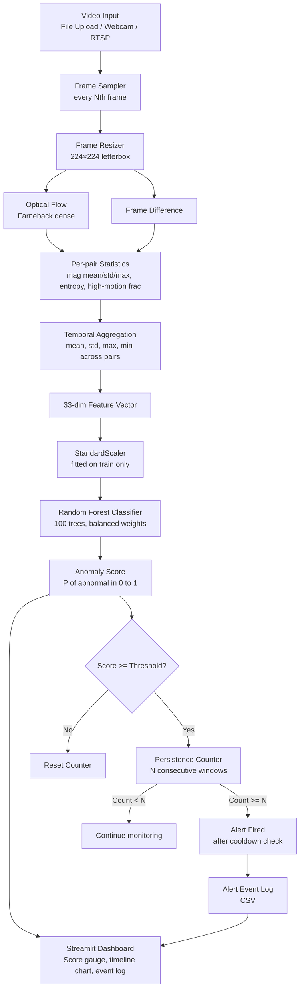

# System Architecture

## Architecture Diagram



## Module Dependency Map

```
app.py
├── src.dashboard.components
├── src.dashboard.visualizations
├── src.models.baseline (load_model, predict)
├── src.inference.video_inference (analyse_video)
├── src.inference.realtime (RealtimeAnalyser)
├── src.inference.alerts (AlertManager)
└── src.utils.paths (load_config, get_path)

scripts/inspect_dataset.py
└── src.data.inventory → src.data.validate

scripts/prepare_dataset.py
├── src.data.inventory (load_inventory)
├── src.data.split_dataset (split_manifest)
└── src.features.video_features (build_feature_matrix)
        └── src.features.motion_features (extract_video_features)
                └── src.data.extract_frames (resize_frame)

scripts/train_model.py
└── src.models.train → src.models.baseline

scripts/evaluate_model.py
└── src.models.evaluate (compute_metrics, plot_confusion_matrix)
```

## Data Flow

```
Dataset Videos
    │
    ▼ scripts/inspect_dataset.py
dataset/dataset_manifest.csv   (43 rows, metadata per video)
    │
    ▼ scripts/prepare_dataset.py
dataset_manifest.csv + split column
generated_data/features/features_train.npz   (9, 33)
generated_data/features/features_val.npz     (3, 33)
generated_data/features/features_test.npz    (5, 33)
    │
    ▼ scripts/train_model.py
models/baseline_model.pkl          (StandardScaler + RandomForest)
outputs/reports/train_metadata.json
    │
    ▼ scripts/evaluate_model.py
outputs/reports/evaluation_metrics.json
outputs/plots/confusion_matrix.png
outputs/plots/roc_curve.png
    │
    ▼ app.py / scripts/quick_infer.py
Inference results (real-time or batch)
outputs/logs/alerts.csv
```

## Key Design Decisions

| Decision | Choice | Reason |
|----------|--------|--------|
| Feature type | Dense optical flow + frame diff | Motion-based, small dataset compatible |
| Classifier | Random Forest | Small dataset, interpretable, probabilistic |
| Scaler integration | Inside sklearn Pipeline | Prevents leakage, single checkpoint |
| Split level | Video-level | Prevents frame-level leakage |
| Alert logic | Threshold + persistence + cooldown | Prevents alarm flooding |
| Dashboard | Streamlit | Python-native, zero frontend code |
